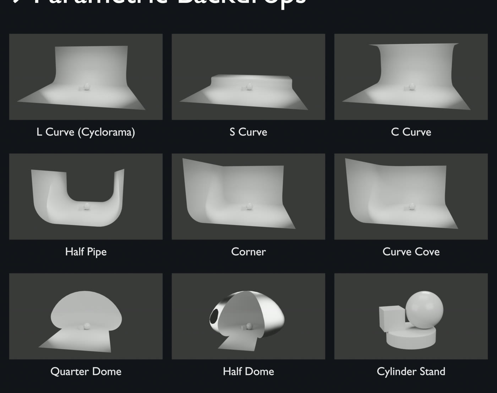
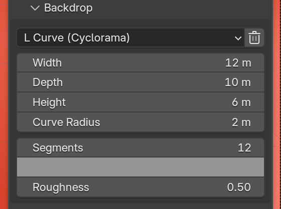

# Backdrops & Floor

## Backdrop

Open **Backdrop**, choose a shape and click **Add**. A rig has one backdrop.
Applying a kit creates one for you if **Set Backdrop** is on.

{ width="360" }

| Shape | What it is |
|---|---|
| L Curve (Cyclorama) | Floor sweeping up into one back wall |
| S Curve | Floor stepping up to a raised plateau |
| C Curve | Floor, back wall and an overhanging ceiling |
| Half Pipe | Floor between two curved side walls |
| Corner | Back wall and side wall meeting at a sharp corner |
| Curve Cove | Back wall and side wall with a rounded corner |
| Quarter Dome | Half-dome shell wrapping behind the subject |
| Half Dome | Dome shell around the subject, open at the front |
| Cylinder Stand | Round product pedestal |

### Controls

- **Shape dropdown** switches shape. The new shape loads its own default
  sizes.
- **Size controls** change with the shape: Width, Depth, Height, the curve
  radii, **Wrap** for the domes and **Side** for Corner and Curve Cove.
- **Segments** sets how smooth the curves are.
- The colour swatch and **Roughness** set the backdrop's material.
- The trash icon removes the backdrop.

Everything stays editable after you add the backdrop.

## Floor

Open **Floor**, set **Floor Size** and click **Add Shadow Catcher**. The
floor is invisible in the render except for the shadows that fall on it, so
your model can sit on a transparent or HDRI background. It works in Cycles
and EEVEE.

!!! note
    The backdrop and floor do not follow **Rig Transform**. Use **Fit Rig to
    Selection** to move them under a model.
