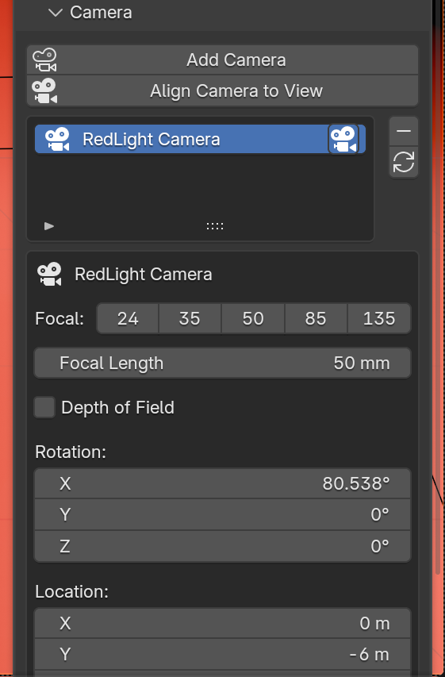

# Camera

{ width="360" }

| Button | What it does |
|---|---|
| **Add Camera** | Adds a camera aimed at the rig and makes it the scene camera. |
| **Align Camera to View** | Moves the selected camera to match the current viewport view. |

## The camera list

Every RedLight camera on the rig. Click a row to edit that camera. The camera
icon on a row makes it the scene's active (render) camera.

| Button | What it does |
|---|---|
| Minus | Removes the selected camera. |
| Refresh | Rebuilds the list. |

## Editing a camera

| Control | What it does |
|---|---|
| **Focal** buttons | One-click 24, 35, 50, 85 or 135 mm. |
| **Focal Length** | Any focal length. |
| **Depth of Field** | Turns depth of field on. |
| **F-Stop**, **Blades**, **Rotation**, **Ratio** | The aperture settings. |
| **Focus** | The object to focus on. The eyedropper sets it to the active object. |
| **Focus Distance** | Used when no focus object is set. |
| **Rotation**, **Location** | The camera's transform. |

Cameras do not follow **Rig Transform**, so turning the rig changes the
lighting without moving your framing.
