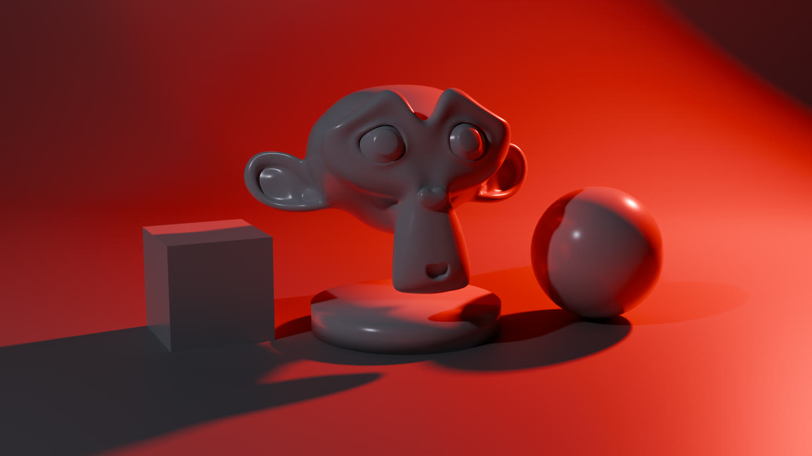

# RedLight Studio Kit

**One-click studio lighting, backdrops, cameras and HDRIs for Blender.**

RedLight Studio Kit puts a complete lighting studio in Blender's N-panel.
Drop a rig on your model, pick a look from 60 studio kits, and render.
Every light, backdrop and camera stays live and editable in the same panel.

- :material-download: **[Installation](installation.md)**: install, update, uninstall
- :material-rocket-launch: **[Quick Start](quick-start.md)**: a lit scene in under a minute
- :material-lightbulb-group: **[Studio Kits](kits.md)**: 60 looks in 7 categories
- :material-format-list-bulleted: **[Kit List](kit-list.md)**: every kit, with previews

## What it does

1. **Add a rig.** One controller holds every light, so the whole studio
   moves, rotates and scales together.
2. **Apply a kit.** A kit sets the lights, the world colour and the backdrop
   colour in one click.
3. **Tune.** Edit any light, swap the backdrop shape, add a camera or an
   HDRI, all without leaving the panel.

## What's included

- 60 studio kits: Product, Portrait, Dramatic, Colour Mood, Glass &
  Jewellery, Natural and Projection
- 12 projection kits that use real shadow masks, so the patterns render in
  EEVEE and Cycles
- 9 parametric backdrop shapes and a shadow-catcher floor
- An inline light editor, quick light presets, Master and Exposure
- Cameras with focal presets and depth of field
- An HDRI browser for your own HDRI folder
- Gobo images and 32 bundled IES profiles (Cycles)

## Requirements

- Blender **4.2 or newer**. Tested on 4.5 LTS, 5.0, 5.1 and 5.2.
- EEVEE or Cycles. See **[EEVEE & Cycles](render-engines.md)** for the two
  features that need Cycles.
- Windows, macOS or Linux.
