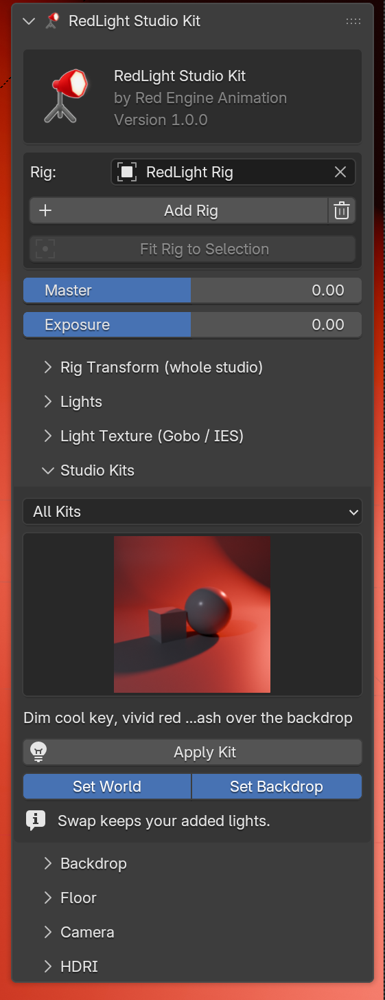

# The Panel

RedLight lives in the 3D Viewport sidebar (`N`) under the **RedLight** tab.

{ width="360" }

## Header

The logo, the product name and the installed version.

## Rig

| Control | What it does |
|---|---|
| **Rig** | The rig the panel is editing. Pick another rig here if the scene has several. |
| **Add Rig** | Creates a new rig at the world origin. |
| Trash icon | Removes the active rig with its lights, floor, backdrop and cameras. |
| **Fit Rig to Selection** | Moves the studio under the selected object and scales it to fit. Needs a selected object. |

See **[The Rig](rig.md)**.

## Master and Exposure

| Control | What it does |
|---|---|
| **Master** | Dims or brightens every rig light together, in stops (-10 to +10). It changes each light's Power, keeping their balance. |
| **Exposure** | Sets Blender's own per-light Exposure value on every rig light, in stops. |

New lights and newly applied kits pick up both values.

## Sections

Each section opens and closes with the arrow next to its name.

| Section | Page |
|---|---|
| Rig Transform (whole studio) | [The Rig](rig.md) |
| Lights | [Lights](lights.md) |
| Light Texture (Gobo / IES) | [Gobo & IES](light-textures.md) |
| Studio Kits | [Studio Kits](kits.md) |
| Backdrop, Floor | [Backdrops & Floor](backdrops.md) |
| Camera | [Camera](camera.md) |
| HDRI | [HDRI](hdri.md) |

**Rig Transform** only appears once a rig exists.
