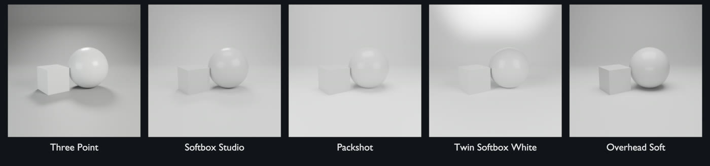
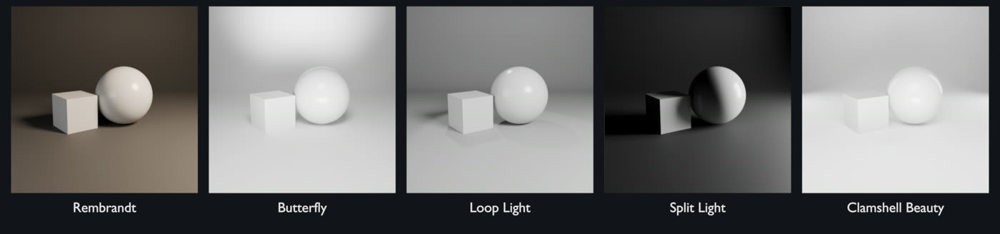
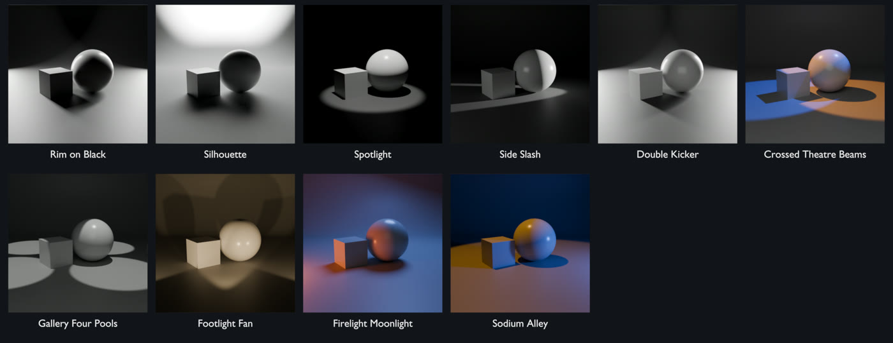
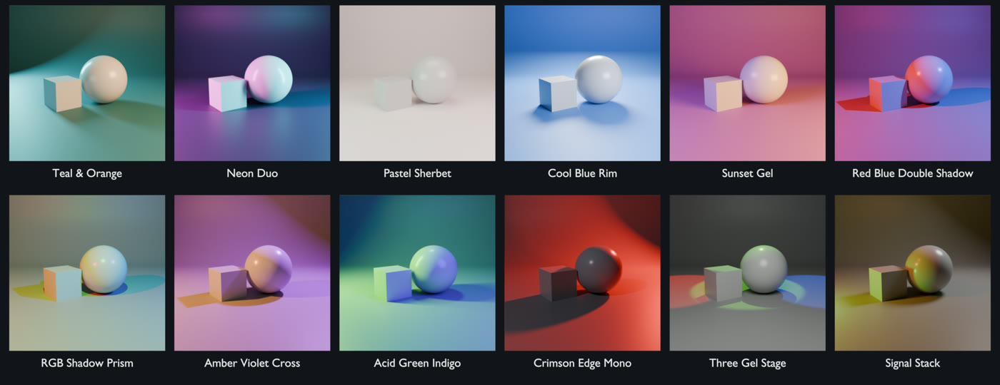
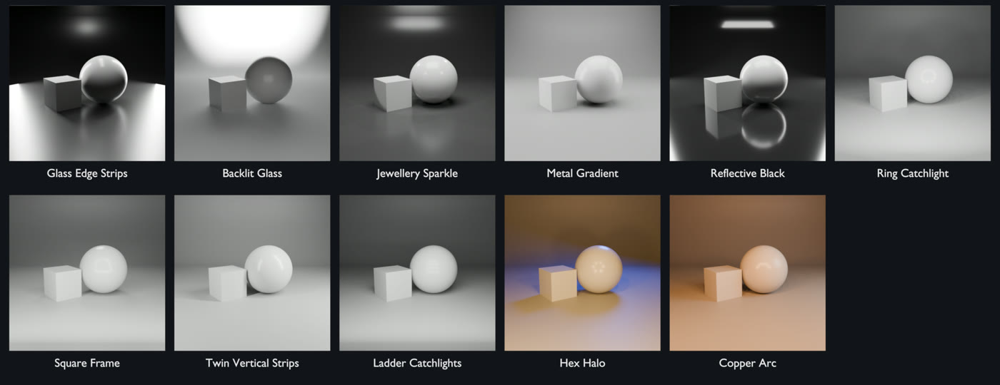
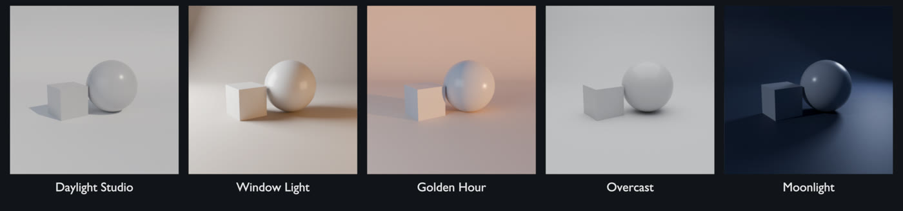
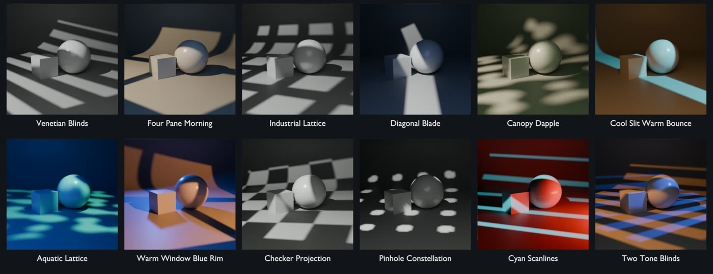

# Kit List

All 60 studio kits, by category. The number is the kit's position in
the **All Kits** grid.

## Product

| # | Kit | Lights | Description |
|---|---|---|---|
| 1 | **Three Point** | 3 | Classic key, fill and rim on a dark grey cyc |
| 2 | **Softbox Studio** | 4 | Big soft key and fill with a top light, light grey cyc |
| 3 | **Packshot** | 3 | High top light with twin low fills on bright white |
| 4 | **Twin Softbox White** | 3 | Two tall softboxes either side, background washed white |
| 5 | **Overhead Soft** | 2 | One huge overhead softbox with a low front strip |

## Portrait

| # | Kit | Lights | Description |
|---|---|---|---|
| 6 | **Rembrandt** | 2 | High 45-degree warm key, faint fill, dark background |
| 7 | **Butterfly** | 3 | Key high above camera, low bounce fill, lifted background |
| 8 | **Loop Light** | 3 | Soft key just off-axis, gentle fill and a hair spot |
| 9 | **Split Light** | 1 | A single side strip lighting exactly half the subject |
| 10 | **Clamshell Beauty** | 4 | Stacked softboxes above and below plus twin rim strips |

## Dramatic

| # | Kit | Lights | Description |
|---|---|---|---|
| 11 | **Rim on Black** | 2 | Two strip lights carving edges out of total black |
| 12 | **Silhouette** | 1 | Glowing backdrop, subject kept in shadow |
| 13 | **Spotlight** | 1 | One hard overhead spot pooling on a dark stage |
| 14 | **Side Slash** | 2 | A raking hard spot from the side with a whisper of fill |
| 15 | **Double Kicker** | 3 | Twin back kickers with a faint frontal fill |
| 46 | **Crossed Theatre Beams** | 3 | Two high crossed spotlights with a localized haze volume; amber and blue |
| 47 | **Gallery Four Pools** | 5 | Four tight overhead museum spots make a repeated floor pattern |
| 50 | **Footlight Fan** | 3 | Three low upward spots cast tall divergent shadows onto the backdrop |
| 51 | **Firelight Moonlight** | 3 | Very low warm practical key with a large cool overhead backlight |
| 52 | **Sodium Alley** | 2 | Tall amber practical above-left, hard low blue side fill, deep shadows |

## Colour Mood

| # | Kit | Lights | Description |
|---|---|---|---|
| 16 | **Teal & Orange** | 3 | Warm orange key against a cool teal rim and set |
| 17 | **Neon Duo** | 2 | Magenta and cyan strips from opposite sides |
| 18 | **Pastel Sherbet** | 3 | Pink, mint and peach softboxes on a pastel cyc |
| 19 | **Cool Blue Rim** | 2 | Cool key and a bright rim on a deep blue set |
| 20 | **Sunset Gel** | 2 | Low orange key with a violet fill |
| 41 | **Red Blue Double Shadow** | 2 | Two small saturated opposing sources create separate red and blue cast shadows |
| 42 | **RGB Shadow Prism** | 3 | Three hard RGB sources give multicolored overlapping shadow regions |
| 43 | **Amber Violet Cross** | 3 | Warm hard side key and violet rear-side key cross on a neutral stage |
| 44 | **Acid Green Indigo** | 3 | Narrow lime side strip, deep indigo fill, and a cool top accent |
| 45 | **Crimson Edge Mono** | 3 | Dim cool key, vivid red rim and a crimson wash over the backdrop |
| 48 | **Three Gel Stage** | 4 | Three distinct colored spot pools with a soft neutral subject key |
| 55 | **Signal Stack** | 4 | Red, amber, and green practical point lights stacked vertically at camera left |

## Glass & Jewellery

| # | Kit | Lights | Description |
|---|---|---|---|
| 21 | **Glass Edge Strips** | 3 | Tall strips behind-left and right define glass edges on black |
| 22 | **Backlit Glass** | 2 | Bright-field: a lit white wall behind, dark glass outlines |
| 23 | **Jewellery Sparkle** | 5 | Soft top light plus four pin spots for facet sparkle, in a dome |
| 24 | **Metal Gradient** | 3 | Big overhead and uneven side banks for long metal reflections |
| 25 | **Reflective Black** | 3 | Top bank and twin strips over a glossy black floor |
| 36 | **Ring Catchlight** | 12 | Twelve small area lights make a ring-shaped reflection in the sphere |
| 37 | **Square Frame** | 5 | Four rectangular softboxes form a square catchlight, with a restrained rear rim |
| 38 | **Twin Vertical Strips** | 3 | Paired tall narrow boxes at front-left and front-right create two elongated reflections |
| 39 | **Ladder Catchlights** | 5 | Five horizontal strip lights stack repeated rectangular highlights on the sphere |
| 40 | **Hex Halo** | 7 | Six amber area lights encircle the reflection, with a blue rear edge |
| 60 | **Copper Arc** | 8 | Seven warm small softboxes form a curved catchlight; broad neutral side fill |

## Natural

| # | Kit | Lights | Description |
|---|---|---|---|
| 26 | **Daylight Studio** | 2 | Crisp sun with a cool skylight fill on white |
| 27 | **Window Light** | 2 | Tall cool window from the left, warm interior bounce, room corner |
| 28 | **Golden Hour** | 2 | Low warm sun grazing in, cool sky fill |
| 29 | **Overcast** | 1 | Shadowless diffuse top light under a grey sky |
| 30 | **Moonlight** | 2 | Dim blue moon from the side with a cold rim |

## Projection

| # | Kit | Lights | Description |
|---|---|---|---|
| 31 | **Venetian Blinds** | 2 | Hard neutral projector through six horizontal slots; low neutral fill |
| 32 | **Four Pane Morning** | 2 | Warm four-pane window projection with cool ambient fill |
| 33 | **Industrial Lattice** | 2 | Small rectangular apertures cast a crisp grid across the stage |
| 34 | **Diagonal Blade** | 2 | Narrow diagonal aperture carves a slash of neutral light; dim blue fill |
| 35 | **Canopy Dapple** | 2 | Irregular perforated mask produces scattered sun patches, green bounce fill |
| 49 | **Cool Slit Warm Bounce** | 2 | Cool narrow projection cuts through a broad warm base fill |
| 53 | **Aquatic Lattice** | 2 | Cyan irregular projected patches and a deep blue broad fill; no caustic simulation required |
| 54 | **Warm Window Blue Rim** | 3 | Large warm four-pane projection, small blue rear rim, cool low fill |
| 56 | **Checker Projection** | 2 | Black-and-white checker aperture throws a repeated square illumination pattern |
| 57 | **Pinhole Constellation** | 2 | A drilled gobo projects many small circular light patches across the objects and floor |
| 58 | **Cyan Scanlines** | 2 | Cyan horizontal slot projection with a low red opposing strip |
| 59 | **Two Tone Blinds** | 3 | Opposing warm and cool slotted projectors overlap to create colored bands |
