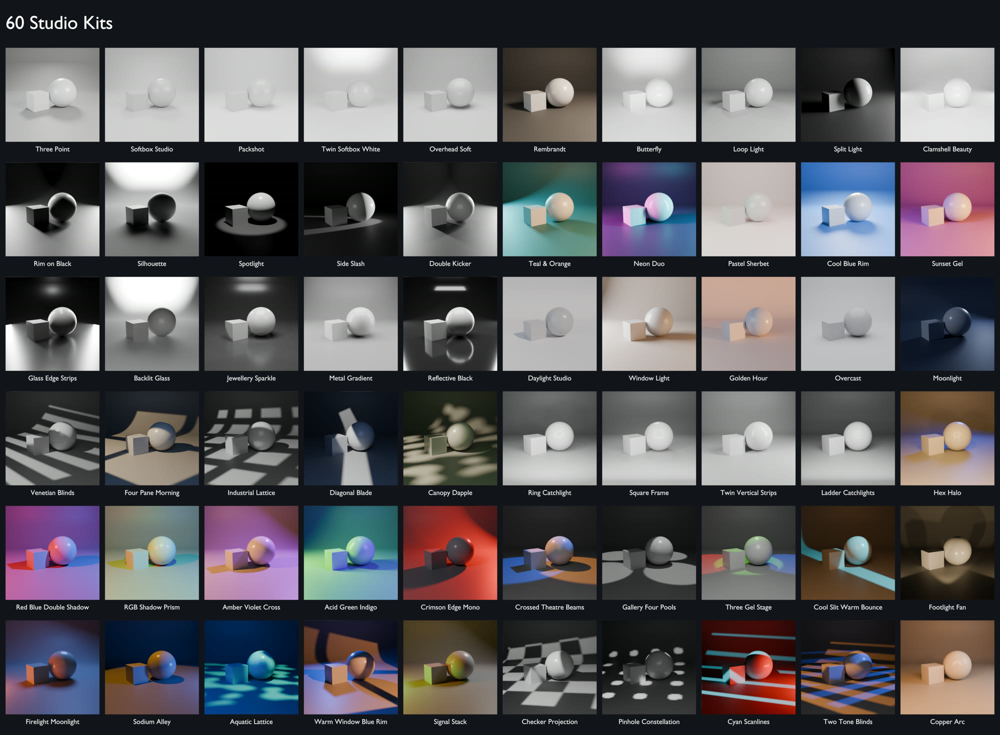

# Studio Kits

A kit is a complete look: the lights, the world colour and the backdrop
colour. RedLight ships 60 of them in 7 categories.

## Applying a kit

1. Open **Studio Kits**.
2. Choose a category in the dropdown, or leave it on **All Kits**.
3. Click the thumbnail to open the grid and pick a kit. Its description
   appears under the thumbnail.
4. Click **Apply Kit**.

## What a swap keeps

Applying a kit replaces **only the lights that came from a kit**. It keeps:

- lights you added with **Add Light**,
- the floor and cameras,
- your backdrop's shape and size (only its colour changes).

## Set World and Set Backdrop

Two toggles under **Apply Kit**, both on by default.

| Toggle | On | Off |
|---|---|---|
| **Set World** | The kit sets the world (background) colour. This replaces a RedLight HDRI. | Your world is left alone. Use this to keep an HDRI. |
| **Set Backdrop** | The kit sets the backdrop colour, and creates its backdrop if the rig has none. | No backdrop is created or recoloured. |

## Categories

| Category | Kits | For |
|---|---|---|
| Product | 5 | Clean, even light for products and packshots |
| Portrait | 5 | Classic portrait patterns for characters and busts |
| Dramatic | 10 | Low-key, hard-light and stage looks |
| Colour Mood | 12 | Coloured gels, tinted sets and coloured shadows |
| Glass & Jewellery | 11 | Edge strips and shaped reflections for glossy surfaces |
| Natural | 5 | Sun, sky and window looks |
| Projection | 12 | Patterns: blinds, windows, grids, dapple, scanlines |

Every kit is listed with its preview in the **[Kit List](kit-list.md)**.

## Projection kits

Projection kits throw a pattern across the scene. Each one places a black
mask with holes in it in front of a spot light, so the pattern is a real
shadow. That is why they work in EEVEE as well as Cycles.

- The mask is parented to its light. Move or aim the light and the pattern
  follows.
- The mask cannot be selected in the viewport, so you can't knock it out of
  place. It is hidden from the camera.
- Deleting the light, or swapping the kit, removes its mask.
- A larger **Radius** on the light gives softer pattern edges.
