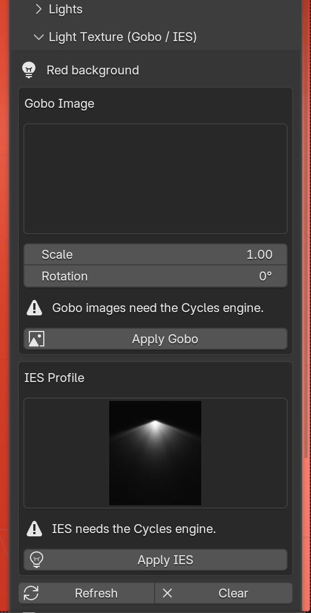

# Gobo & IES

The **Light Texture (Gobo / IES)** section shapes the beam of a single
light.

!!! warning "Cycles only"
    Gobo images and IES profiles only render in **Cycles**. EEVEE ignores
    them, and the panel shows a warning when the render engine is not Cycles.
    For patterns in EEVEE, use the **Projection** [studio kits](kits.md#projection-kits).

{ width="360" }

## Which light?

The section acts on the selected light: the active light in the viewport,
or the highlighted row in the [Lights](lights.md) list. Its name is shown at
the top. To texture several lights, select each one and click Apply again.

## Gobo image

A gobo projects an image through the light, like a slide. It works best on a
**Spot** light.

1. Set **Gobo / IES Folder** in the add-on preferences to a folder of images
   (`.png`, `.jpg`, `.tif`, `.tga`, `.bmp`). White lets light through, black
   blocks it.
2. Click **Refresh**, pick an image in the grid and click **Apply Gobo**.
3. **Scale** and **Rotation** adjust the projection.

No gobo images are bundled in version 1.0.

## IES profile

An IES profile gives a light the real spread pattern of a physical fixture.
It suits **Spot** and **Point** lights.

1. Pick a profile in the grid. 32 profiles are bundled.
2. Click **Apply IES**.

Your own `.ies` files in the **Gobo / IES Folder** appear in the same grid.

## Clear

**Clear** removes the gobo or IES from the selected light.

## Credits

The bundled profiles are the IES Lights Pack by
[LeoMoon](https://leomoon.com/), GPL-3.0, redistributed unmodified.
