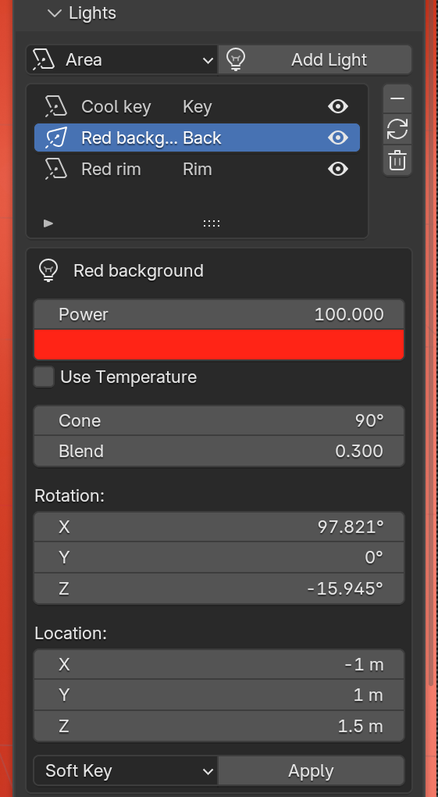

# Lights

{ width="360" }

## Adding a light

Choose a type (**Area**, **Spot**, **Sun** or **Point**) and click **Add
Light**. The light joins the active rig, aimed at its centre. Lights you add
this way survive kit swaps.

## The light list

Every light on the rig, with its role (Key, Fill, Rim, Back, Top). Click a
row to edit that light. Selecting a light in the viewport or Outliner works
too.

| Button | What it does |
|---|---|
| Minus | Removes the selected light. |
| Refresh | Rebuilds the list, for example after you delete a light in the Outliner. |
| Trash | Deletes every light on the rig. The floor stays. |

## Editing a light

The box under the list edits the selected light directly.

| Control | Applies to |
|---|---|
| **Power**, colour | All lights |
| **Use Temperature**, **Temperature** (Kelvin) | All lights (Blender 4.3 and newer) |
| Shape, **Size X**, **Size Y** | Area |
| **Cone**, **Blend** | Spot |
| **Angle** | Sun |
| **Radius** | Point |
| **Rotation**, **Location** | All lights (a Sun only uses rotation) |

## Light presets

Pick a preset in the dropdown at the bottom of the editor and click
**Apply**. It sets the selected light's power, colour, size and temperature.

| Preset | Look |
|---|---|
| Soft Key | Broad, neutral key |
| Hard Key | Small, punchy key with crisp shadows |
| Cool Fill | Low, cool fill |
| Warm Rim | Warm separation light |
| Golden Hour | Warm, low-temperature wash |

## Things to know

- RedLight's lights are hidden from the camera. They light the scene and show
  in reflections, but the light itself never appears in the render.
- **Master** and **Exposure** at the top of the panel act on every rig light
  at once. See [The Panel](interface.md#master-and-exposure).
