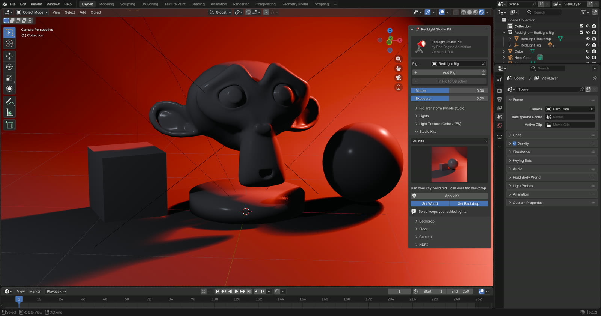

# Quick Start

A lit, framed scene in under a minute.

1. Open the 3D Viewport sidebar (`N`) and click the **RedLight** tab.
2. Select your model and click **Fit Rig to Selection**. This creates a rig,
   moves it under the model and sizes the studio to fit.
3. Open **Studio Kits**, click the thumbnail and pick a kit. Use the category
   dropdown above it to narrow the grid.
4. Click **Apply Kit**. The lights, world colour and backdrop appear.
5. Switch the viewport to **Rendered** to see the result.

## Next steps

- Try another kit. Swapping replaces only the kit's lights; anything you
  added yourself stays.
- Dim or brighten everything with **Master**.
- Change the backdrop shape in **[Backdrops & Floor](backdrops.md)**.
- Add a camera in **[Camera](camera.md)**.
- Edit one light in **[Lights](lights.md)**.

!!! tip "No model selected?"
    You can skip step 2. **Apply Kit** creates a rig at the world origin if
    the scene has none. Kits are sized for a subject about 1 m tall.
