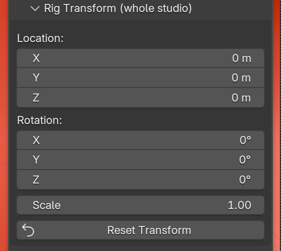

# The Rig

A rig is one controller (an Empty) with every light parented to it. Move,
rotate or scale the controller and the whole studio follows.

## Creating and removing

- **Add Rig** creates a rig at the world origin.
- **Apply Kit**, **Add Light** and **Fit Rig to Selection** create one for you
  if the scene has none.
- The trash icon next to **Add Rig** removes the active rig and everything it
  made: lights, floor, backdrop and cameras.

A scene can hold several rigs. The **Rig** field at the top of the panel
chooses which one you are editing.

## Fit Rig to Selection

Select your model and click **Fit Rig to Selection**. RedLight:

1. moves the rig to the base of the model,
2. scales the studio to the model's size,
3. moves the floor and backdrop to match,
4. adjusts light power so the exposure stays the same.

Kits are authored for a subject about 1 m tall, so this is how you light
something much bigger or smaller with the same look.

## Rig Transform

{ width="360" }

| Control | What it does |
|---|---|
| **Location**, **Rotation** | Move and turn the whole studio. |
| **Scale** | Scales the whole studio. Light power follows, so a bigger studio is not darker. |
| **Reset Transform** | Back to the world origin, no rotation, scale 1. |

!!! note "The floor and backdrop stay put"
    Rig Transform moves the lights only. The floor, backdrop and cameras are
    not parented to the rig, so rotating the rig sweeps the light around a
    fixed set. Fit Rig to Selection is the tool that moves them.
